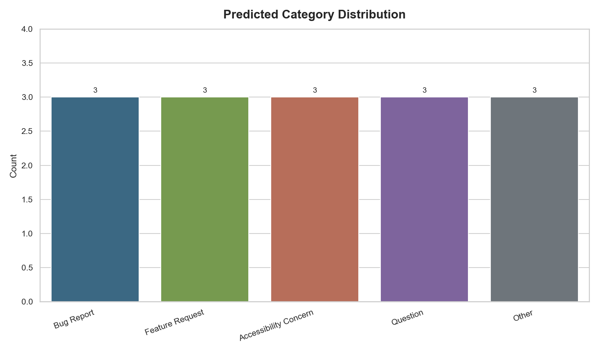
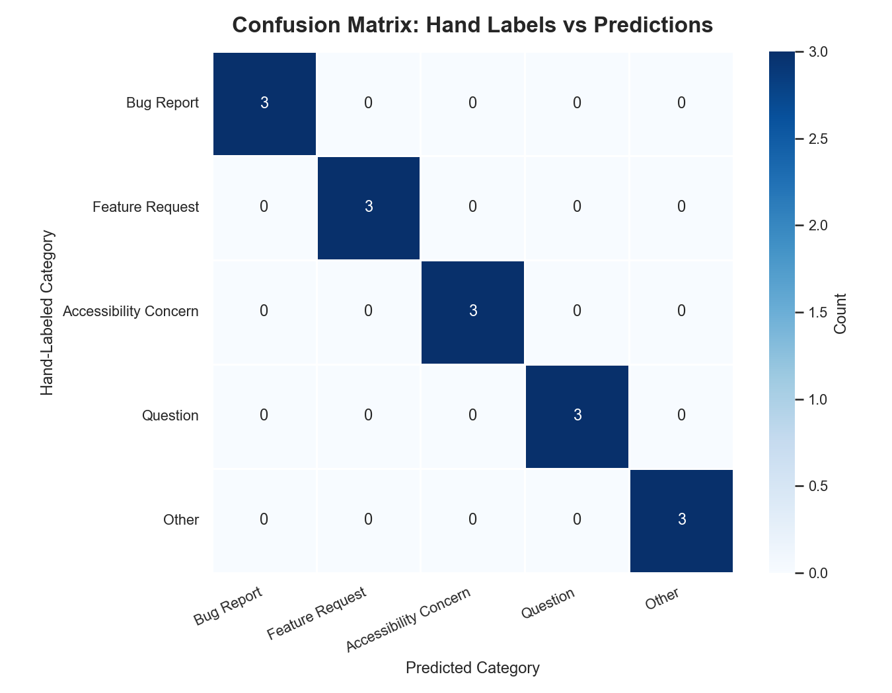

# Feedback Triage Classifier

This project classifies user feedback into five groups:

- Bug Report
- Feature Request
- Accessibility Concern
- Question
- Other

It can read feedback from a local JSON file or fetch GitHub issues, send each item to an LLM, save the predictions to a CSV file, and make a couple of simple charts.

## Folder Structure

```text
src/
  fetch.py
  classify.py
  batch.py
  evaluate.py
examples/
  sample_issues.json
  sample_predictions.csv
results/
  category_distribution.png
  confusion_matrix.png
requirements.txt
README.md
.gitignore
```

## Setup

```bash
python3 -m venv .venv
source .venv/bin/activate
pip install -r requirements.txt
```

## API Keys

The classifier supports OpenAI and Anthropic.

```bash
export LLM_PROVIDER=openai
export OPENAI_API_KEY="your_key_here"
```

You can also use:

```bash
export LLM_API_KEY="your_key_here"
export LLM_MODEL="your_model_name"
```

For GitHub issue fetching, `GITHUB_TOKEN` is optional but helps with rate limits.

## Run It

Preview the included sample data:

```bash
python -m src.fetch --source local --input examples/sample_issues.json
```

Classify a single piece of feedback:

```bash
python -m src.classify "The export button does nothing when I click it."
```

Classify a batch:

```bash
python -m src.batch \
  --source local \
  --input examples/sample_issues.json \
  --output examples/my_predictions.csv
```

Fetch issues from GitHub:

```bash
python -m src.fetch \
  --source github \
  --repo pandas-dev/pandas \
  --per-page 10 \
  --output examples/github_issues.json
```

Evaluate predictions:

```bash
python -m src.evaluate \
  --predictions examples/sample_predictions.csv \
  --distribution-plot results/category_distribution.png \
  --confusion-plot results/confusion_matrix.png
```

## Categories

| Category | Meaning |
| --- | --- |
| Bug Report | Something is broken or behaving incorrectly. |
| Feature Request | The user wants something added or improved. |
| Accessibility Concern | The issue affects accessibility, such as screen readers, keyboard navigation, or contrast. |
| Question | The user is asking how something works. |
| Other | Anything that does not fit the other categories. |

## Results

The sample predictions file uses 15 hand-labeled examples. The included evaluation gets all 15 correct.




